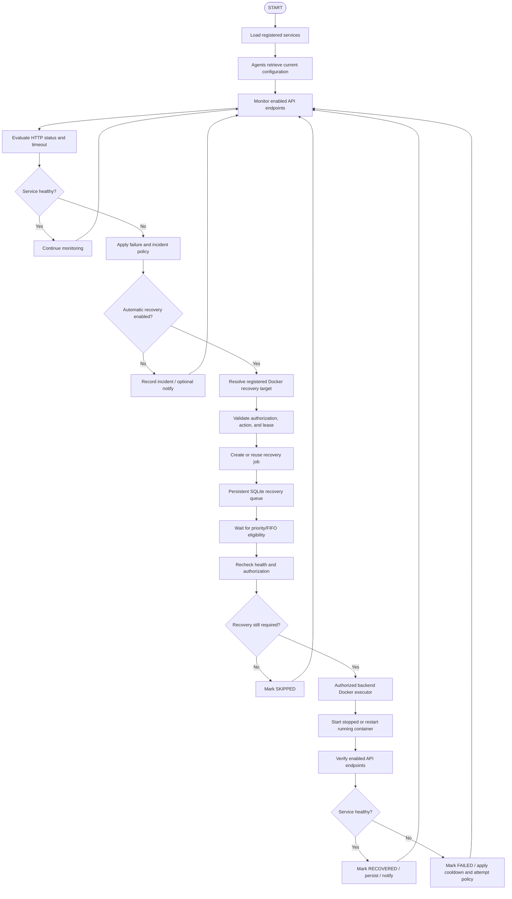
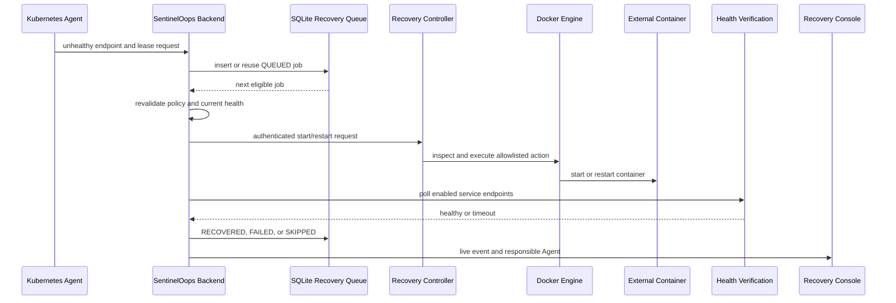

# SentinelOops

## Kubernetes-Powered Infrastructure Monitoring & Automated Recovery

SentinelOops is a self-hosted monitoring and recovery platform for local and development infrastructure. Kubernetes-hosted SentinelOops Agents monitor configured HTTP endpoints, report incidents to the SentinelOops backend, and coordinate authorized recovery of registered Docker containers through a restricted recovery controller.

The central operating loop is **Observe → Detect → Decide → Act → Verify**.

Kubernetes manages the Agent workloads; it does not directly manage or restart external Docker services. Docker recovery is performed by the backend through the allowlisted `recovery-controller`, which is the only component in the default Compose stack with Docker Engine socket access.

For example, when a Docker-hosted API becomes unavailable, an Agent Pod detects the failed health check, acquires recovery ownership, submits an authenticated request to SentinelOops, and the backend queues an authorized start/restart. The backend verifies the API before marking recovery successful.

The repository has two deliberately separate parts: `sentinelops/` is the SentinelOops control plane, while `test-service/` is an optional independent demo target. SentinelOops starts with zero registered endpoints and never assumes the demo service exists.

## Contents

- [What is implemented](#what-is-implemented)
- [Architecture](#architecture)
- [End-to-end recovery pipeline](#end-to-end-recovery-pipeline)
- [How Kubernetes Agents work](#how-kubernetes-agents-work)
- [Service Settings and recovery targets](#service-settings-and-recovery-targets)
- [Sequential multi-container recovery](#sequential-multi-container-recovery)
- [Technology stack](#technology-stack)
- [Installation and quick start](#installation-and-quick-start)
- [Configuration reference](#configuration-reference)
- [Docker and Kubernetes infrastructure](#docker-and-kubernetes-infrastructure)
- [Recovery Console](#recovery-console)
- [Security and recovery authorization](#security-and-recovery-authorization)
- [Testing and development](#testing-and-development)
- [Troubleshooting](#troubleshooting)
- [Project structure](#project-structure)
- [Screenshots and demo](#screenshots-and-demo)
- [Roadmap](#roadmap)

## What is implemented

The current repository includes:

- React/TypeScript/Vite dashboards served by the SentinelOops backend.
- Fastify/Node.js APIs with SQLite persistence using `better-sqlite3` and WAL mode.
- Prometheus file-based service discovery, Blackbox Exporter HTTP probing, and alert rules.
- Grafana dashboards provisioned from `install/config/grafana`.
- Service Settings at `/services`, including multiple endpoints and optional Docker recovery mappings.
- Kubernetes Recovery with actual cluster discovery, setup actions, live topology, Agent status, recovery log, and terminal.
- Kubernetes Agents that retrieve current configuration and perform endpoint health checks.
- SQLite-backed Agent ownership records and a persistent sequential recovery queue.
- An allowlisted Docker recovery controller for start, restart, status, and development outage-test operations.
- Manual Recovery and Kubernetes Recovery modes, Server-Sent Events, polling, and optional SMTP notifications.
- A real bash PTY terminal exposed through an authenticated WebSocket bridge.

The optional `test-service` and `test-service-2` applications run outside Kubernetes and are demonstration recovery targets.

## Independent components

- `test-service/` is an optional demo API on port 8080. It is never installed by SentinelOps.
- `sentinelops/` contains the monitoring product.
- `install/` deploys SentinelOps, Prometheus, Grafana, and Blackbox Exporter with persistent named volumes.

## Clean installation and verification

```bash
docker compose -f test-service/docker-compose.yml up -d --build
curl http://localhost:8080/api/health
curl http://localhost:8080/api/users
curl http://localhost:8080/api/products
curl http://localhost:8080/metrics

chmod +x install/install.sh
./install/install.sh
```

Open `http://localhost:3005/setup` and register the demo endpoints through the wizard. The installer does not register or assume them. To scrape real demo metrics, set `PROMETHEUS_METRICS_TARGET=host.docker.internal:8080` and `PROMETHEUS_METRICS_APPLICATION=demo-service` in `install/.env` before installation. Docker Desktop on Windows/macOS supports `host.docker.internal`; Linux users can use the installer host-gateway mapping or a reachable Docker-network DNS name. Remote targets must be explicitly authorized.

PowerShell:

```powershell
docker compose -f test-service/docker-compose.yml up -d --build
docker compose --env-file install/.env -f install/docker-compose.yml up -d --build
Start-Process http://localhost:3005/setup
```

## Observe. Detect. Recover.

SentinelOops is a local-first infrastructure monitoring and incident-response project. It combines a Node.js test service, Prometheus metrics and alert rules, Grafana dashboards, a custom Alert Manager, and a restricted recovery controller into a reproducible Docker Compose workflow.

[](https://nodejs.org/)
[](https://www.typescriptlang.org/)
[](https://react.dev/)
[](https://prometheus.io/)
[](https://grafana.com/)
[](https://docs.docker.com/compose/)

Repository: [github.com/jimmy007bond/SentinelOops](https://github.com/jimmy007bond/SentinelOops)

## Overview

SentinelOops makes the complete failure loop visible in a small, reproducible environment:

1. The test service exposes health and Prometheus metrics.
2. Prometheus scrapes the service every two seconds and evaluates alert rules.
3. Alert Manager polls Prometheus, records firing and resolved incidents, and exposes a live dashboard.
4. Optional SMTP notifications are queued and recorded in SQLite.
5. Approved recovery runbooks can call a private, allowlisted recovery controller.

The project is intended for local development, observability demonstrations, and engineering portfolio review. It is not presented as a production deployment blueprint.

## Demo

No checked-in video or screenshot assets were found in the repository. These are clearly labeled placeholders rather than fabricated media.

- Demo video: Not included; add a real recording link here.
- Dashboard screenshot: Not included; add an image under docs/assets when available.
- Incident detection screenshot: Not included; add an image under docs/assets when available.
- Recovery screenshot: Not included; add an image under docs/assets when available.

## Key Features

- Real service health monitoring through /health and Prometheus /metrics.
- Two-second Prometheus scraping and evaluation intervals.
- Grafana dashboard provisioned with availability, CPU, memory, request-rate, and latency panels.
- Alert Manager incident polling with FIRING and RESOLVED lifecycle detection.
- SQLite-backed incident, notification, job, and recovery execution state.
- SMTP configuration through the dashboard, with encrypted saved settings and Nodemailer delivery.
- Server-Sent Events plus polling for live dashboard updates.
- Structured recovery runbooks with manual execution and optional automatic mode.
- Private recovery controller restricted to the Compose test-service container and approved actions.
- Recovery verification through the service health endpoint and persisted execution history.

## Architecture

~~~mermaid
flowchart LR
    B[Browser]
    T[test-service<br/>Node.js / TypeScript]
    P[Prometheus<br/>2s scrape + rules]
    G[Grafana<br/>provisioned dashboard]
    A[Alert Manager<br/>Fastify + React + SQLite]
    R[Recovery Controller<br/>private internal API]
    D[Docker Engine API]
    S[SMTP server]
    V1[(Prometheus volume)]
    V2[(Grafana volume)]
    V3[(SentinelOps SQLite volume)]

    T -- /metrics --> P
    T -- /api/health and /metrics --> P
    T -- API health --> A
    P -- query API --> A
    P -- PromQL --> G
    A -- SSE / polling --> B
    B -- dashboard and settings --> A
    A -- queued email --> S
    A -- restricted recovery request --> R
    R -- start/restart/status --> D
    R -- health verification --> T
    P --- V1
    G --- V2
    A --- V3
~~~

The production installation is defined by `install/docker-compose.yml` and deploys SentinelOps, Prometheus, Grafana, and Blackbox Exporter. The optional demo service is defined separately in `test-service/docker-compose.yml`.

### Kubernetes recovery topology

SentinelOops remains the control plane. Kubernetes Agents monitor registered endpoints and request recovery; they do not receive Docker access. Docker actions remain behind the private recovery controller.

~~~mermaid
flowchart TB
    Operator[Operator browser]
    SO[SentinelOops control plane]
    Terminal[Authenticated Kubernetes terminal]
    Kind[kind cluster]
    CP[Control-plane node]
    Workers[Worker nodes]
    Agents[SentinelOops Agent Pods]
    Target[External Docker test-service]
    RC[Recovery Controller]
    Docker[Docker Engine]

    Operator <--> SO
    SO -->|read-only discovery and explicit setup commands| Terminal
    Terminal --> Kind
    Kind --> CP
    Kind --> Workers
    Workers --> Agents
    Agents -->|health checks, leases, events| SO
    Agents -->|probe| Target
    SO --> RC --> Docker --> Target
~~~

### Kubernetes screen lifecycle

~~~mermaid
flowchart TD
    Open[Open Kubernetes Recovery] --> Loading[Read-only cluster discovery]
    Loading -->|cluster reachable| Console[Recovery Console]
    Loading -->|cluster absent| Setup[Cluster Setup]
    Loading -->|discovery error| Retry[Error + Retry]
    Retry --> Loading
    Setup -->|manual create/check/namespace/deploy| Loading
    Setup -->|Go to Console| Console
    Console -->|shutdown icon + confirmation| Setup
~~~

The console defaults from actual `kind`/Kubernetes discovery. A missing namespace or zero Agent Pods produces a warning without creating infrastructure. The terminal remains mounted while switching screens, preserving its WebSocket/PTy session.

### Incident and recovery flow

~~~mermaid
sequenceDiagram
    participant Service as Monitored service
    participant Prom as Prometheus/Blackbox
    participant SO as SentinelOops
    participant UI as Dashboard
    participant Agent as Kubernetes Agent
    participant RC as Recovery Controller
    participant Docker as Docker Engine

    Service->>Prom: Health probe and metrics
    Prom->>SO: Query and alert state
    SO->>SO: Persist incident lifecycle
    SO-->>UI: SSE and polling updates
    Agent->>SO: Failure event and recovery lease
    SO->>RC: Approved allowlisted action
    RC->>Docker: Start/restart/check target
    Docker-->>RC: Verified container state
    RC-->>SO: Recovery result
    SO->>Service: Health verification
    SO-->>UI: Recovered or failed incident
~~~

## End-to-end recovery pipeline



Agents currently submit a confirmed unreachable endpoint for immediate action. The SQLite queue still performs ownership, authorization, deduplication, serialization, and verification. A failure or timeout is finalized so it cannot block later queued jobs.

## How Kubernetes Agents work

Agents are small Node.js processes packaged in `sentinelops/kubernetes-agent`. They do not mount the Docker socket, do not receive terminal credentials, and do not execute arbitrary Docker commands.

### Configuration and health checking

Each Agent periodically calls `/api/kubernetes/agent/config`. The response contains enabled registered endpoints, expected status codes, timeout and cooldown settings, recovery policy, and Prometheus traffic configuration. Configuration changes therefore propagate without rebuilding an Agent image or redeploying Pods.

For each endpoint, an Agent sends a bounded GET or HEAD request from the Agent network, compares the response with the expected status, and emits `api.healthy` or `api.unhealthy` events. It creates an incident when the current failure policy is reached and continues checking other endpoints while another service is recovering.

An unreachable API does not prove that its container is stopped. The queue rechecks the service and the recovery controller inspects the actual Docker state before choosing `START_CONTAINER` or the configured restart action.

### Traffic Monitor

The Agent has a traffic-monitor module that queries the configured Prometheus request metric and reports aggregate requests-per-second samples. It does not intercept individual requests or act as a network proxy. Prometheus application metrics and Agent endpoint health checks are separate signals.

### Recovery Engine and coordination

When an eligible endpoint fails, the Agent resolves the registered service ID, acquires a backend lease, and sends an authenticated recovery request containing Agent ID, incident ID, monitor ID, lease token, and action. Docker execution remains behind the backend and recovery controller.

Coordination uses lease records in SQLite, not Kubernetes Lease resources. A lease records the normalized service, incident ID, owner Agent ID, token, expiry, and update time. The backend validates the lease before accepting recovery. Each Agent also guards against concurrent requests for the same service in its own process.

The live identity chain is:

| Identity | Meaning |
| --- | --- |
| Kubernetes Pod name | Runtime identity shown in topology |
| Agent ID | Process identity sent in heartbeats and events |
| Service ID | Stable registered-service identity |
| Endpoint ID | Stable health-check identity |
| Incident ID | Failure lifecycle identity |
| Recovery job ID | SQLite queue identity |

The topology uses actual Kubernetes node and Pod discovery. Recovery events carry the responsible Agent ID, so the console highlights the Agent associated with the real recovery event rather than simulating ownership.

Agents heartbeat their Pod name, namespace, node, status, module readiness, and last health-check time. If an Agent disappears, its lease expires and another Agent can acquire ownership for a later request. Kubernetes Deployment behavior recreates failed Pods; there is no separate custom Kubernetes controller in this repository.

## Service Settings and recovery targets

Open Service Settings at `/services`. A service can contain multiple HTTP endpoints and may optionally map to an authorized Docker container.

The implemented form supports:

- Service name and description.
- Multiple endpoint friendly names, URLs, expected HTTP statuses, and enabled state.
- Docker Engine/host label, container ID, and display name.
- Monitoring enabled state, interval, health-check timeout, and failure threshold.
- Automatic recovery, recovery action, priority, cooldown, verification timeout, and maximum attempts.

Automatic recovery is only enabled when a valid container mapping exists and the operator explicitly enables it. Monitoring-only services are supported.

| Registered service | Endpoint | Recovery target |
| --- | --- | --- |
| Authentication Service | `/api/login` | `auth-container` |
| Payment Service | `/api/payments` | `payment-container` |
| Orders Service | `/api/orders` | `orders-container` |

The names above are examples, not built-in records. Container discovery comes from the recovery controller and is restricted by its Compose project and service allowlist. The frontend and Agents cannot submit arbitrary Docker commands.

Multiple endpoints may share one container, and multiple service records may map to one container. The queue uses the Docker Engine plus container ID as an active-target key. Verification checks all enabled endpoints belonging to the recovering service.

## Sequential multi-container recovery

The queue is implemented in `sentinelops/backend/src/recovery-queue.ts` and persisted in SQLite. Its states are `QUEUED`, `RECOVERING`, `VERIFYING`, `RECOVERED`, `FAILED`, and `SKIPPED`.

For three unhealthy services, the intended execution is:

```text
Authentication → Recover → Verify
Payment        → Recover → Verify
Orders         → Recover → Verify
```

Implemented queue behavior includes:

- One active recovery job globally in the queue worker.
- High priority before Normal before Low.
- FIFO order within the same priority.
- Deduplication by service/incident and active Docker target.
- Health and authorization revalidation immediately before execution.
- Skipping a service that recovered naturally while queued.
- Bounded Docker and verification timeouts.
- Finalizing failed jobs so subsequent jobs continue.
- SQLite persistence across backend process restarts.

Per-service cooldown and maximum attempts are provided in service configuration and used by Agents before new requests are submitted. The queue does not blindly repeat a failed Docker action.



The default controller allowlist is deliberately narrow and is configured for the local Compose demonstration services. Registering an arbitrary production container does not by itself grant permission to operate it.

## Technology Stack

| Area | Verified technologies |
| --- | --- |
| Frontend | React, TypeScript, Vite |
| Backend | Node.js, TypeScript, Fastify |
| Persistence | SQLite, better-sqlite3, WAL mode |
| Email | Nodemailer, configurable SMTP |
| Observability | Prometheus, PromQL, Grafana |
| Recovery | Dedicated Node.js controller, Docker Engine API |
| Infrastructure | Docker, Docker Compose, named volumes |
| Validation | Node test runner, TypeScript builds, promtool |

### Stack Summary

- Frontend: React, TypeScript, and Vite.
- Backend: Node.js, TypeScript, and Fastify.
- Persistence: SQLite with better-sqlite3 and WAL mode.
- Email: Nodemailer with configurable SMTP delivery.
- Monitoring: Prometheus and PromQL.
- Dashboards: Grafana.
- Recovery: Node.js recovery controller using the Docker Engine API.
- Infrastructure: Docker, Docker Compose, and persistent named volumes.
- Validation: Node.js test runner, TypeScript builds, and Prometheus promtool.

The current active Compose stack does not require PostgreSQL, Kafka, Kubernetes, or an active Alertmanager container.

## Getting Started

### Prerequisites

- Docker Desktop with Docker Compose v2.
- Node.js 22 and npm for local repository checks.
- An SMTP account or app password if email notifications are required.

### Clone and configure

~~~powershell
git clone https://github.com/jimmy007bond/SentinelOops.git
cd SentinelOops
Copy-Item install/.env.example install/.env
~~~

Review `install/.env` before starting. The installer generates this file automatically when it does not exist. Use development-only values and never commit the file:

~~~dotenv
GRAFANA_ADMIN_USER=admin
GRAFANA_ADMIN_PASSWORD=change-this-locally
RECOVERY_CONTROLLER_TOKEN=replace-with-a-long-random-token
SENTINELOPS_AUTH_ENABLED=false
SENTINELOPS_ADMIN_TOKEN=change-this-locally
SETTINGS_ENCRYPTION_KEY=replace-with-a-long-random-key
EMAIL_ENABLED=false
SMTP_HOST=smtp.example.com
SMTP_PORT=465
SMTP_SECURE=true
SMTP_USERNAME=sender@example.com
SMTP_PASSWORD=app-password
SMTP_FROM=sender@example.com
SMTP_RECIPIENTS=operator@example.com
~~~

SMTP_PASSWORD is only a placeholder. Do not paste a real credential into source control or logs.

### Start the stack

~~~powershell
docker compose --env-file install/.env -f install/docker-compose.yml up -d --build --remove-orphans
docker compose --env-file install/.env -f install/docker-compose.yml ps
~~~

| Component | URL |
| --- | --- |
| Test service | [http://localhost:8080](http://localhost:8080) |
| Prometheus | [http://localhost:9090](http://localhost:9090) |
| Grafana | [http://localhost:3000](http://localhost:3000) |
| Alert Manager | [http://localhost:3005](http://localhost:3005) |

The recovery controller listens only on the internal Docker network at port 8090; it is not published to the host.

### Check health

~~~powershell
Invoke-RestMethod http://localhost:3005/health
Invoke-RestMethod http://localhost:3005/ready
docker compose --env-file install/.env -f install/docker-compose.yml config --quiet
~~~

Open Grafana and select the provisioned SentinelOops - Service Monitoring dashboard. Prometheus should show the sentinelops-test-service target as UP at http://localhost:9090/targets.

### Stop the stack

~~~powershell
docker compose --env-file install/.env -f install/docker-compose.yml down
~~~

Do not add --volumes unless you intentionally want to delete Prometheus, Grafana, and SQLite data volumes.

## Incident Recovery Walkthrough

1. Start the stack and open Alert Manager at http://localhost:3005.
2. Configure SMTP settings in the dashboard if notifications are needed.
3. In Recovery, create an enabled runbook targeting test-service. Choose START_CONTAINER for a stopped service or RESTART_CONTAINER for a running service, configure /health, and keep execution manual.
4. Simulate an outage without deleting data:

~~~powershell
docker compose -f test-service/docker-compose.yml stop test-service
~~~

5. After the alert rule pending period, Alert Manager records ServiceDown as FIRING and the dashboard updates through its live stream and polling path.
6. Open the incident or Recovery panel, approve the displayed action, and execute the runbook.
7. The private recovery controller validates the Compose project, service label, image, action, and token before using the Docker Engine API. It does not execute a user-provided shell command.
8. Alert Manager checks the service health endpoint twice before recording SUCCESS.
9. Verify the result:

~~~powershell
Invoke-RestMethod http://localhost:8080/api/health
Invoke-RestMethod http://localhost:3005/api/recovery/executions
docker compose ps
~~~

The recovery socket is mounted only into recovery-controller, not into the public-facing Alert Manager process. Docker socket access is highly privileged and should be limited to local development.

## Load Testing

The repository includes a manually launched, localhost-only load-testing CLI under load-testing/. It targets the implemented test-service route at http://localhost:8080/ and never starts automatically. It supports smoke, benchmark, stress, billion, stop, and report commands with bounded virtual users, request rate, timeouts, failure limits, latency limits, duration limits, emergency stop, and large-test confirmation.

```powershell
npm run loadtest -- smoke
npm run loadtest -- benchmark --vus=20 --rate=250
npm run loadtest -- stop
npm run loadtest -- report
```

The billion command is available for a deliberately approved local experiment only; it is not run during setup or validation. Tests over one million requests require typing RUN or passing --yes. Reports are generated as JSON and Markdown under load-testing/reports/ and are ignored by Git.

While a test is running, aggregate metrics are exposed at http://localhost:9464/metrics and scraped by Prometheus. The provisioned SentinelOops - Load Testing Grafana dashboard shows request rate, total requests, error rate, latency percentiles, active virtual users, load-generator CPU and memory, response-byte throughput, and progress. Metrics use bounded labels and do not create one database record per request.

## Project Structure

~~~text
SentinelOops/
├── sentinelops/                # Control plane application
│   ├── backend/                 # Fastify API, persistence, polling, recovery APIs
│   ├── frontend/                # React dashboard and Kubernetes Recovery screens
│   ├── kubernetes-agent/        # Agent image and coordination protocol
│   ├── kubernetes-terminal/     # Authenticated terminal gateway
│   └── recovery-controller/     # Restricted Docker recovery API
├── install/                    # Standalone Compose installer and observability config
├── test-service/               # Optional independent monitored demo service
├── load-testing/               # Manual localhost-only load generator
├── helm-lab/                   # Kubernetes/Helm development material
├── package.json                # Root build and validation scripts
└── README.md
~~~

## Security and recovery authorization

The trust boundaries are:

1. Browser users call management APIs authenticated by the backend when authentication is enabled.
2. Agents call dedicated backend endpoints and identify themselves in heartbeats and events.
3. The backend validates registered service configuration, recovery policy, incident identity, lease ownership, and Docker target identity.
4. The recovery controller requires its bearer token and checks the configured Compose project, service allowlist, container identity, and primary image policy.
5. Only the recovery controller has Docker socket access in the default Compose deployment.

Keep management ports local unless authentication and network controls are intentionally configured. Protect `install/.env`, Grafana credentials, recovery tokens, SMTP credentials, and `SETTINGS_ENCRYPTION_KEY`. Saved SMTP passwords are encrypted by the backend, but the encryption key must itself be protected.

Docker socket access is highly privileged and can control the Docker host. The socket is isolated to the controller by default, but the controller remains a privileged trust boundary. The terminal can also be granted Docker or kubeconfig access through explicit overrides and should be treated as administrator-level access.

## Security Considerations

- Compose bindings are localhost-oriented for local development, but should not be treated as an internet-facing deployment.
- Keep .env out of version control. SMTP passwords, Grafana credentials, controller tokens, and encryption keys are secrets.
- SETTINGS_ENCRYPTION_KEY protects saved SMTP settings at rest; protect the key itself through the environment or a secret manager.
- Keep management authentication enabled and replace development tokens before sharing the application.
- The recovery controller validates the exact Compose project and service identity and supports a small approved action set. It does not provide arbitrary command execution.
- Docker Engine socket access can provide broad control over the Docker host. The socket is isolated to the controller, but the controller remains a privileged trust boundary.
- Avoid printing .env, resolved Compose configuration, or SMTP settings in support logs.

## Docker and Kubernetes infrastructure

### Compose services

| Service | Purpose | Ports and persistence |
| --- | --- | --- |
| `kubernetes-terminal` | Authenticated bash PTY with kubectl, kind, Helm, curl, and git | Internal `8787`; `kubernetes_terminal_workspace`; optional Docker socket override |
| `sentinelops` | React assets, Fastify API, SQLite, Agent coordination, queue worker, and terminal bridge | Host `127.0.0.1:3005` → container `8081`; `sentinelops_data`; shared file-SD volume |
| `prometheus` | Blackbox probes, application metrics, alert rules, and PromQL API | `prometheus_data`; shared file-SD volume |
| `blackbox-exporter` | HTTP probe execution for Prometheus | Internal `9115` |
| `recovery-controller` | Private token-protected Docker recovery boundary | Internal `8090`; Docker socket |
| `grafana` | Provisioned dashboards backed by Prometheus | `grafana_data` |

The Compose network is `sentinelops_install_network`. Only `recovery-controller` mounts the Docker socket in the default stack. The terminal image contains Docker CLI tooling, but Docker Engine access requires its explicit override.

### Kubernetes resources and boundaries

The checked-in Agent manifest defines a Namespace, ServiceAccount, ConfigMap, and Deployment with readiness/liveness probes and resource requests/limits. It does not define a Service, Secret, Role, RoleBinding, or Kubernetes Lease object. Backend SQLite records provide recovery leases. The UI setup workflow can generate a Deployment in the configured namespace with the selected replica count.

The test services remain outside Kubernetes in a separate Docker Compose project. Agent Pods monitor them over HTTP. The backend authorizes recovery, and the controller performs Docker operations. Kubernetes does not directly restart the external service containers.

## Recovery Console

The Kubernetes Recovery Console provides:

- Registered external-service status and per-service outage controls.
- Actual cluster/node/Pod topology discovery.
- Responsible-Agent highlighting from real recovery events.
- Persisted live recovery log.
- SQLite-backed sequential queue state.
- Observe & Recovery policy and incident summary.
- Manual Recovery and Kubernetes Recovery modes.
- A persistent interactive Kubernetes terminal.

When the cluster is reachable, the console is the default screen. When it is absent, the setup screen exposes separate manual operations. Discovery errors show Retry rather than assuming the cluster is absent. The shutdown icon deletes the configured kind cluster only after confirmation; it does not delete Docker services or SQLite history.

## Configuration reference

The installer template is [`install/.env.example`](install/.env.example). Important variables include:

| Variable | Purpose | Default or example |
| --- | --- | --- |
| `SENTINELOPS_WEB_PORT` | Host UI/API port | `3005` |
| `GRAFANA_ADMIN_USER` / `GRAFANA_ADMIN_PASSWORD` | Grafana credentials | `admin` / generated local secret |
| `SETTINGS_ENCRYPTION_KEY` | Encrypts saved SMTP settings | generated local secret |
| `SENTINELOPS_AUTH_ENABLED` | Backend management authentication | installer runtime `false` for localhost |
| `SENTINELOPS_ADMIN_TOKEN` / `SENTINELOPS_SETUP_TOKEN` | Management/setup bearer tokens | empty unless auth is enabled |
| `RECOVERY_CONTROLLER_TOKEN` | Backend/controller shared token | local Compose fallback |
| `RECOVERY_COMPOSE_PROJECT` | Docker Compose project checked by controller | `sentinelops-test-service` |
| `RECOVERY_ALLOWED_SERVICES` | Controller service allowlist | `test-service,test-service-2` |
| `RECOVERY_ALLOWED_IMAGE` | Primary image identity check | `sentinelops/test-service:local` |
| `RECOVERY_HEALTH_URL` | Legacy verification URL | `http://host.docker.internal:8080/api/health` |
| `PROMETHEUS_METRICS_TARGET` | Optional application metrics target | empty |
| `PROMETHEUS_METRICS_APPLICATION` | Label for that target | empty |
| `KUBERNETES_TERMINAL_TOKEN` | Backend/terminal WebSocket token | local fallback |
| `KUBERNETES_TERMINAL_MAX_SESSIONS` | Concurrent PTY limit | `4` |
| `KUBERNETES_AGENT_PROBE_HOST` | Host used for local probe translation | `host.docker.internal` |
| `TERMINAL_TEST_SERVICE_PROXY` | Terminal local test-service proxy | `true` |

`PROMETHEUS_URL`, `GRAFANA_URL`, `BLACKBOX_EXPORTER_URL`, `DATABASE_PATH`, `PROMETHEUS_FILE_SD_PATH`, `PROMETHEUS_METRICS_FILE_SD_PATH`, `RECOVERY_CONTROLLER_URL`, `KUBERNETES_TERMINAL_URL`, `PORT`, and `HOST` are also supplied by Compose for internal connectivity.

## Testing and development

```powershell
npm ci
npm run build:test-service
npm run build:receiver
npm run build:backend
npm run build:recovery-controller
npm run build:agent
npm run build:frontend
npm test
```

`npm test` builds the test service, alert receiver, and backend before running the compiled Node test suites. Existing tests cover alert lifecycle and deduplication, notification validation, endpoint authorization, recovery-mode transitions, queue ordering/deduplication, and traffic calculations.

Safe configuration checks:

```powershell
docker compose --env-file install/.env -f install/docker-compose.yml config --quiet
kubectl apply --dry-run=client -f sentinelops/kubernetes-agent/k8s/agent.yaml
```

There is no single repository lint script. TypeScript compilation and the Node test runner are the primary validations. Do not stop live containers, destroy a kind cluster, or run the outage control in automated tests.

## Troubleshooting

### Cluster discovery or terminal failure

```powershell
docker compose --env-file install/.env -f install/docker-compose.yml ps kubernetes-terminal sentinelops
docker compose --env-file install/.env -f install/docker-compose.yml logs --tail=200 kubernetes-terminal
kind get clusters
kubectl cluster-info --context kind-sentinelops-dev
```

Use Recovery setup Retry after correcting Docker Desktop, the kind context, or terminal authentication. `localhost` inside a container or Pod is not the host; use `host.docker.internal` for host-published services.

### Agent Pods are not Ready

```powershell
kubectl get pods -A -l app=sentinelops-agent -o wide
kubectl describe pods -A -l app=sentinelops-agent
kubectl logs -n sentinelops-system deployment/sentinelops-agent --tail=200
```

Confirm the Agent image is loaded into kind, the backend URL is reachable from the Pod, and the Agent has retrieved configuration.

### Recovery is skipped or rejected

```powershell
docker compose --env-file install/.env -f install/docker-compose.yml logs --tail=200 sentinelops recovery-controller
kubectl logs -n sentinelops-system deployment/sentinelops-agent --tail=200
```

Verify Kubernetes Recovery mode, automatic recovery policy, container mapping, controller allowlist, token, Compose project, image identity, and Docker Engine availability.

### Prometheus or Grafana is stale

```powershell
docker compose --env-file install/.env -f install/docker-compose.yml ps prometheus grafana blackbox-exporter
docker compose --env-file install/.env -f install/docker-compose.yml logs --tail=200 prometheus grafana blackbox-exporter
```

SentinelOops writes target files to the shared `prometheus_file_sd` volume. Prometheus refreshes probe targets every 15 seconds and application metric targets every 2 seconds. Grafana reads Prometheus; it does not own endpoint registration. Unregistering a service removes matching configuration and requests Prometheus series cleanup.

### SMTP or Docker socket problems

Check Email Settings, SMTP host/port/security, credentials, and notification history. For Docker errors, remember that only the recovery controller mounts `/var/run/docker.sock` by default. Do not expose an unauthenticated Docker TCP socket or make the socket world-writable.

## Screenshots and demo

Repository-root screenshots currently available:

- [Traffic Intelligence](Screenshot%202026-11-23%20153724.png)
- [Registered services](Screenshot%202026-11-23%20153801.png)

No checked-in demo video was found, so no fabricated video URL is included. Additional screenshots for Cluster Setup, Agent recovery highlighting, recovery logs, and the terminal can be added under `docs/assets/`.

## Roadmap

The following are future improvements, not current dependencies or implemented guarantees:

- Hardened external control boundary with a separately deployable policy-enforcing service.
- Stronger user authentication, sessions, roles, and audit views.
- PostgreSQL-backed persistence for multi-instance deployments.
- More detailed incident timelines and notification analytics.
- Browser-level end-to-end coverage and checked-in demonstration media.
- Deployment guidance for additional environments, including Kubernetes only if a future deployment requires it.

## Validation

~~~powershell
npm test
npm run build:frontend
docker compose --env-file install/.env -f install/docker-compose.yml config --quiet
docker compose exec -T prometheus promtool check config /etc/prometheus/prometheus.yml
docker compose exec -T prometheus promtool check rules /etc/prometheus/alert-rules.yml
~~~

The repository test command covers the existing Node.js and TypeScript test suites. The frontend build and Compose/Prometheus checks are listed separately so failures are easier to identify.

## Author

**Nizamuddin Ali Ahmed**

- Portfolio: [nizamuddin.online](https://nizamuddin.online)
- GitHub: [NonCoderF](https://github.com/NonCoderF)
- LinkedIn: [nizamuddin-ahmed-827024428](https://www.linkedin.com/in/nizamuddin-ahmed-827024428/)
