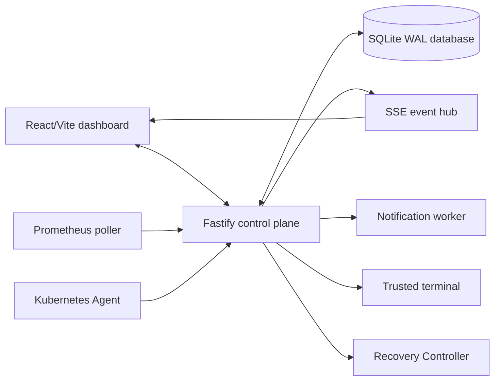
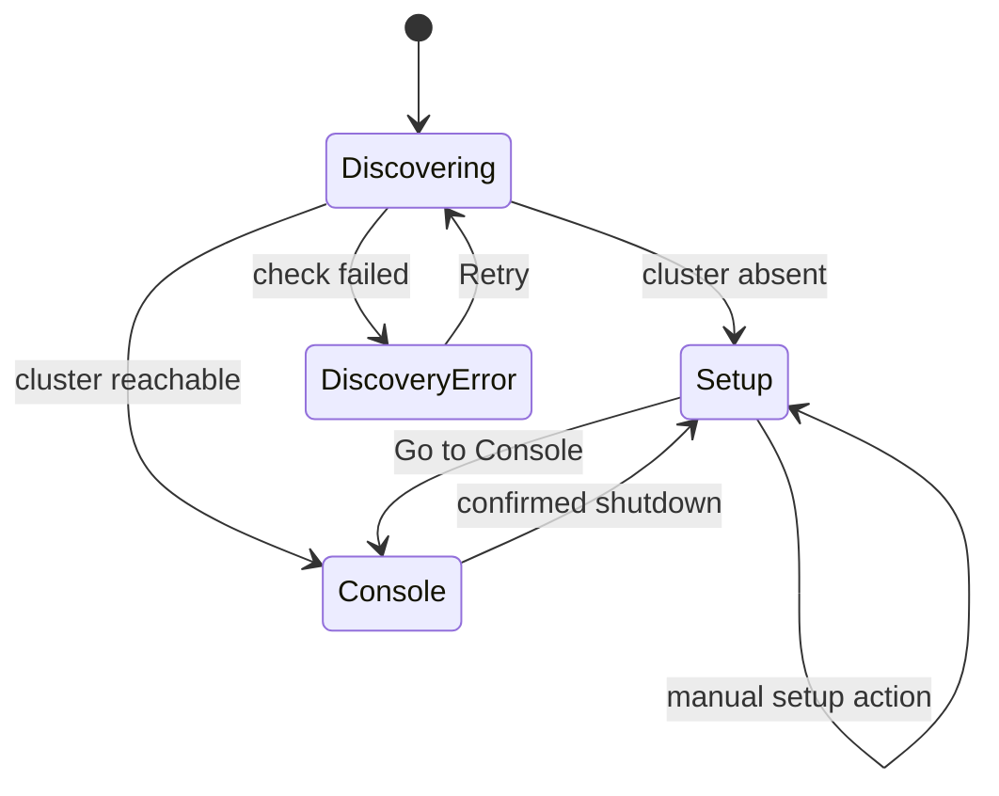

# SentinelOops control plane

This directory contains the deployable SentinelOops application: the Fastify control plane, React/Vite dashboard, Kubernetes Agent tooling, authenticated terminal gateway, and restricted recovery controller.

SentinelOops starts with zero registered endpoints. The independent `test-service` is optional and is never assumed by this application.

## Internal architecture



## Kubernetes Recovery lifecycle



The discovery check is read-only. Setup operations remain explicit and manual:

- Create or inspect the allowlisted kind cluster.
- Create the configured namespace.
- Deploy or inspect Agent Pods.
- Shut down the configured cluster through the confirmed shutdown control.

The terminal remains mounted while switching between Setup and Console, so view changes do not recreate its WebSocket/PTy session.

## API areas

| Area | Routes |
| --- | --- |
| Health | `/health`, `/ready` |
| Setup | `/api/setup/*` |
| Dashboard | `/api/dashboard`, `/api/overview`, `/api/activity` |
| Alerts | `/api/webhooks/alertmanager`, `/api/alerts/*` |
| Recovery | `/api/recovery/*` |
| Kubernetes discovery | `/api/kubernetes/discovery`, `/api/kubernetes/topology` |
| Kubernetes setup | `/api/kubernetes/setup/:operation` |
| Agent protocol | `/api/kubernetes/agent/config`, `/heartbeat`, `/events`, `/lease/acquire`, `/recovery` |
| Terminal | `/api/kubernetes/terminal` WebSocket gateway |

## Build from the repository root

```powershell
npm run build:backend
npm run build:frontend
npm run build:agent
npm run build:recovery-controller
```

The root Dockerfile packages the backend and frontend into the SentinelOops image. The installer persists SQLite, Prometheus, Grafana, and file-discovery state in named volumes.

## Security boundaries

- The public control plane never receives a Docker socket.
- The Recovery Controller validates the Compose project, service identity, image, token, and approved action before touching Docker.
- Kubernetes Agents have no Docker socket and no terminal credentials.
- The terminal is a separate authenticated trust boundary; Docker socket and kubeconfig access are opt-in local-development capabilities.
- Keep SMTP credentials, controller tokens, kubeconfig files, and encryption keys out of source control.

See [KUBERNETES_AGENT.md](KUBERNETES_AGENT.md) and [KUBERNETES_TERMINAL.md](KUBERNETES_TERMINAL.md) for operational details.
